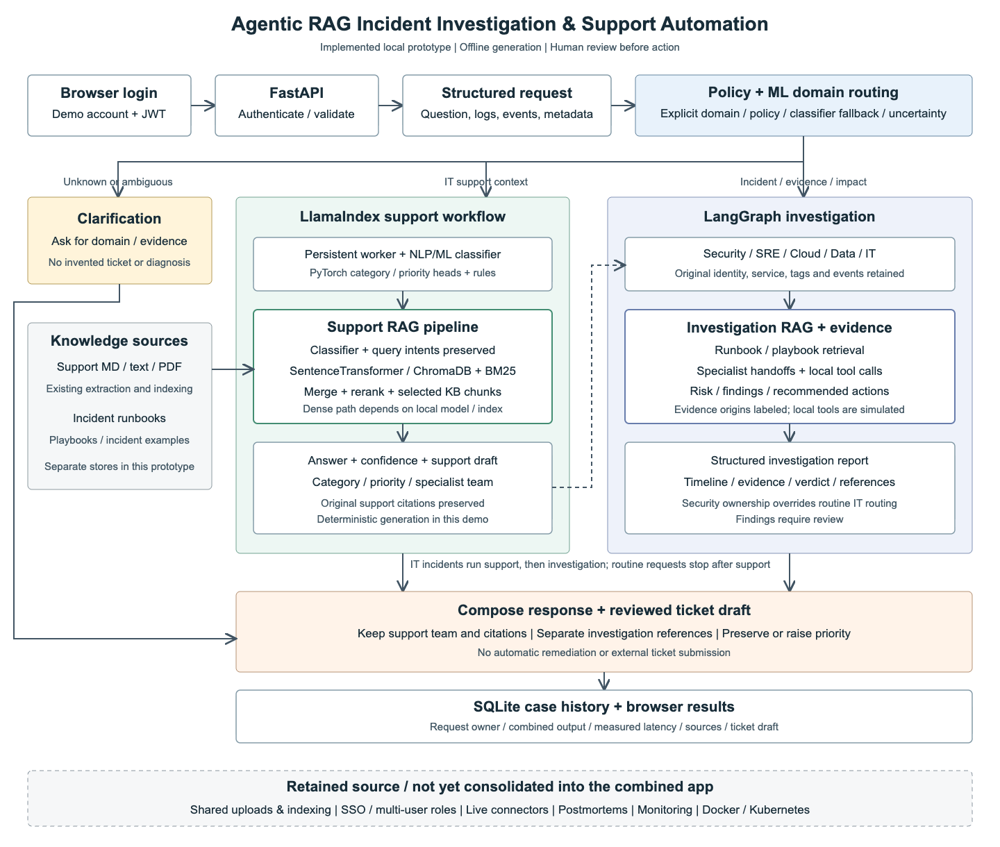

# 🤖 Enterprise Agentic RAG Support Automation Platform

An enterprise IT support prototype using public knowledge-base guidance for source-backed answers, support triage, and incident investigation, built with FastAPI, LlamaIndex, LangGraph, and ML-based routing.

## 🌟 Why This Project Exists

This project helps IT support teams answer repeated questions, find relevant documentation, distinguish routine requests from incidents, and route issues with useful context. This platform brings those steps into one authenticated interface: answer a support question, investigate an incident, or request clarification when the available information is insufficient.

## 🏗️ System Architecture



**High-level workflow**

Login -> POST /jobs -> durable queue + HTTP 202/job ID -> independent worker -> policy + ML routing -> LlamaIndex support and/or LangGraph investigation -> saved case + completion event + user notification.

**Core stack:** FastAPI, LlamaIndex, LangGraph, SentenceTransformers, ChromaDB, BM25, PyTorch, scikit-learn, JWT, and SQLite. The combined interface is a lightweight web UI; the original support application also includes Streamlit.

[Architecture details](platform/ARCHITECTURE.md) | [Vector diagram](platform/architecture.svg)

## ✨ Key Features

- Authentication: JWT-protected requests and user-scoped case history.
- Routing: explicit domain selection, weighted policies, and a trained classifier with abstention thresholds.
- Retrieval: semantic and BM25 search, metadata filtering, and source-aware reranking.
- Investigation: five operational domains with preserved logs, events, identity, and service context.
- Triage: ticket classification, priority, team recommendation, and human-reviewed drafts.
- Transparency: separate support citations and investigation references; simulated evidence is labeled.
- Background jobs: durable submission, immediate job IDs, independent processing, retries, lease recovery, and persistent completion notifications.
- Persistence: SQLite case history and a reusable support-model subprocess.

[Background-job architecture, endpoints, and recovery](platform/BACKGROUND_JOBS.md). The browser uses the queued path; POST /cases remains available for synchronous clients.

## Model Training

Compared TF-IDF, frozen MiniLM, and SetFit-fine-tuned MiniLM on **1,800 synthetic rows** representing 720 scenarios in disjoint topic-family splits. Model and confidence thresholds were selected on validation before opening the final test.

The selected **frozen MiniLM + trained classifier** achieved **96.67% accuracy and 96.57% macro-F1 on 90 final-test cases**. Its accepted coverage was 96.67%, with 97.70% accuracy among accepted predictions. SetFit was trained and evaluated but did not outperform this validation winner. These generated labels remain awaiting independent human review.

[Training protocol and comparison](platform/routing_training/README.md) | [Model card](platform/MODEL_CARD.md). The routing encoder is separate from retrieval embeddings, and the original retrieval encoder and index are retained. Earlier routing metrics below use a different historical dataset.

### QLoRA Classifier Experiments

Completed Qwen3-0.6B domain-classifier training with rank-16 NF4 QLoRA. The second run achieved **95.83% accuracy and 95.82% macro-F1 on 120 synthetic benchmark cases**, versus 86.67% accuracy for the first adapter on those same cases. Security recall was 100% on 20 synthetic security cases, but cloud/production recall fell to 90%. These are small unreviewed synthetic benchmarks, not production guarantees.

The second run completed **300 steps in 15.2 minutes** on a Colab T4, training 4.59 million parameters with **1.69 GiB peak allocated GPU memory**. Classification p95 was **791 ms**, not end-to-end RAG latency. The active application router remains unchanged.

[Verified Qwen v2 results](platform/qlora_training/llama_training/qwen_v2_reference/RESULTS.md) | [Training evidence](platform/qlora_training/llama_training/qwen_v2_reference/training.json) | [Qwen training protocol](platform/qlora_training/retraining_v2/README.md)

The no-token **Llama-3.2-1B-Instruct** experiment also completed: **91.67% accuracy and 91.70% macro-F1**, with 3.41 million trainable parameters and 2.26 GiB peak allocated GPU memory. Its original six-pass classification p95 was 1,283 ms. These use the previously inspected synthetic benchmark; Qwen remains the stronger measured candidate.

[Llama first-run results](platform/qlora_training/llama_retraining/previous_run/RESULTS.md) | [Training evidence](platform/qlora_training/llama_retraining/previous_run/training.json)

A second Llama experiment is **prepared, not yet trained**. It keeps the data unchanged and tests six-class cross-entropy, development macro-F1 checkpoint selection, and single-pass native-token classification. Both original and retrained Llama adapters will use the same new scorer, separating scorer changes from training changes.

**Completed vs. pending experiments**

| Experiment | Status | Accuracy / Macro-F1 |
| --- | --- | --- |
| Qwen3-0.6B QLoRA v2 | Completed and verified | 95.83% / 95.82% |
| Llama-3.2-1B QLoRA first run | Completed and verified | 91.67% / 91.70% |
| Llama direct-classifier retraining | Prepared; Colab run pending | Not measured |

The rows above use the same 120-case synthetic benchmark, already inspected during development. They are not independent production evaluations. Planned retraining improvements are hypotheses, not achieved metrics.

[Second Llama notebook and protocol](platform/qlora_training/llama_retraining/README.md). Public checkpoint downloads explicitly use `token=False`; Meta's license still applies. No model weights or GPU packages are downloaded to the Mac during preparation. The live router remains unchanged; no production endpoint or arbiter is claimed.

To resume retraining, upload [Llama_Retraining_NoToken.ipynb](platform/qlora_training/llama_retraining/Llama_Retraining_NoToken.ipynb) to a hosted Colab T4 runtime and use the locally prepared `llama_retraining_bundle.zip`. No Hugging Face token is required. The bundle and trained adapters are deliberately not committed; rebuilding the bundle requires your original `llama_qlora_results.zip` plus the checked-in code and data. Download `llama_retrained_results.zip` after the run and verify it before publishing new metrics.

## External API Adapters

Implemented five opt-in REST adapters: **Jira Cloud, Microsoft Graph, Google Drive, OpenAI, and Slack**. Authenticated endpoints expose ticket creation, user-profile lookup, document retrieval, grounded model answers, and notifications. Case actions require confirmation and use persistent duplicate-submission protection.

The adapters are contract-tested with simulated HTTP responses. They are disabled by default; live credential-backed verification is pending. [Configuration, endpoints, and verification scope](platform/EXTERNAL_APIS.md).

## 📊 Measured Results

The primary retrieval suite now includes **100 answerable questions across 80 scenario groups**, plus 20 unsupported controls. It measured **93% expected-source Recall@3, 94% Hit@3, and 34.33% fixed-slot Precision@3**. Precision over returned unique sources was **86.67%**. The annotated source count limits fixed-slot Precision@3 to 37% on this set; these figures should not be compared directly with the differently composed 20-query suite.

[Expanded retrieval results, formulas, and limitations](platform/retrieval_evaluation/README.md). The retriever was unchanged during this run; broader testing exposed source-scope and multi-source gaps.

[Support workload and fresh-RAG evaluation](platform/UNIVERSITY_EVALUATION.md) reports the 65,000-request synthetic workload separately from uncached retrieval quality.

| Support evaluation | Result |
| --- | --- |
| Synthetic repeated-FAQ HTTP requests | 65,000/65,000 successful; zero errors |
| Warm-cache throughput, concurrency 16 | 1,057 requests/second |
| Warm-cache p95 / p99 latency | 54.00 / 202.59 ms |
| Fresh support source coverage | 40/40 development questions |
| Fresh support request p95 | 389.17 ms |

The workload repeats 40 questions using one demo identity and a fully warm cache. It does not represent unique users or fresh RAG execution on each request. Previous results below are historical controlled evaluations.

| Metric | Result | Evaluation scope |
| --- | --- | --- |
| Hybrid domain-routing accuracy | 75% (18/24) | Separate synthetic test split |
| Recall@3 | 100% | 20 controlled support questions |
| Precision@3 | 46.7% | Same 20 questions; fixed denominator of 3 |
| Ticket category / team / priority accuracy | 90% / 95% / 100% | Same controlled support set |
| Incident regression cases | 12/12 | Offline expected-behavior checks |
| Automated tests | 109 passing | Platform, integrations, background jobs, training/retrieval audits, and Colab protocol/safe-export checks |
| Mixed-workload p95 latency | Approximately 390 ms | Historical local offline worker benchmark; 8 requests at concurrency 2 |

These are small, controlled evaluations, not production performance guarantees. The latency benchmark excludes live LLM calls and does not represent sustained load. Regression success does not establish factual correctness. Semantic groundedness and faithfulness have not been independently evaluated.

[Latest evaluation](platform/EVALUATION_V3.md) | [Raw results](platform/evaluation-v3/) | [Worker benchmark](platform/EVALUATION_V2.md) | [Model card](platform/MODEL_CARD.md)

## 📚 Datasets

- Knowledge corpus: 15 support documents (5 original guides plus 10 project-authored summaries of public IT support guidance), alongside the separate incident runbooks. [Source manifest](platform/support/public_sources.json).
- Support evaluation: 40 synthetic questions across 10 IT service topics. [Question set](platform/university_eval_questions.json). These are development cases, not real student records or independent test labels.
- Workload evaluation: 65,000 synthetic repetitions of those 40 public FAQs. Each request uses JWT authentication, domain routing, cached support delivery, and SQLite persistence.
- Routing model comparison: 1,800 synthetic rows from 720 base scenarios, grouped into 1,620 train / 90 validation / 90 test rows. Independent human label review remains pending.
- Legacy routing fallback: 120 synthetic examples retained for compatibility, separate from the new comparison.
- Primary retrieval evaluation: 100 answerable questions in 80 scenario groups plus 20 unsupported controls. The original 20 questions are retained as a historical cohort.
- Incident evaluation: 12 scenarios with expected outcomes.
- The separate PyTorch category/priority classifier retains its 80-example dataset; it is not retrained in the new domain-routing experiment.

Knowledge documents are indexed for retrieval; separate synthetic routing examples are used for classifier training. The routing dataset has disjoint text splits but is not independently reviewed real-world data.

## 🚀 Run Locally

Use Python 3.12 for the API and Python 3.11 for the support environment. Two environments keep the inherited dependencies isolated.

```sh
git clone https://github.com/swathiblrs/Enterprise-Agentic-RAG-Support-Automation-Platform.git
cd Enterprise-Agentic-RAG-Support-Automation-Platform/platform
python3.12 -m venv .venv-api
.venv-api/bin/pip install -r incident/requirements.txt pytest
python3.11 -m venv .venv-support
.venv-support/bin/pip install -r support/requirements.txt
export SUPPORT_PYTHON="$PWD/.venv-support/bin/python"
cd support
"$SUPPORT_PYTHON" -m src.ingest
cd ..
.venv-api/bin/python run_local.py
```

Initial ingestion downloads the embedding model and builds the local index. The API uses offline generation and does not submit external actions. Model downloads require internet access. Dependencies are not fully locked; fresh-environment reproducibility remains a limitation.

Open http://127.0.0.1:8765 and log in with `demo` / `local-demo-only`. This is a local demo account, not production identity management. Keep the server bound to localhost. JWTs expire on server restart. The first support request loads models; later requests reuse the worker.

## 🧪 Tests and Training

From `platform/`, with `SUPPORT_PYTHON` set and ingestion complete:

```sh
.venv-api/bin/python -m pytest test_combined.py test_regressions.py test_improvements.py test_university.py test_external_apis.py test_jobs.py test_routing_training.py test_retrieval_evaluation.py test_qlora_protocol.py test_qlora_retraining.py test_llama_training.py test_llama_retraining.py -q
"$SUPPORT_PYTHON" train_domain_classifier.py
```

To reproduce the HTTP workload test, follow [UNIVERSITY_EVALUATION.md](platform/UNIVERSITY_EVALUATION.md). The public FAQ cache expires after one hour and is restricted to the 40 exact curated FAQ questions. Restart the server after updating documents to invalidate the cache.

The legacy train_domain_classifier.py command retrains the original portable TF-IDF fallback. The new three-model experiment has separate reproduction and deployment instructions in platform/routing_training/README.md. Historical evaluation artifacts are retained for traceability; some historical scripts reference the original local benchmark paths.

## 📂 Project Structure

```text
platform/
  api.py              # Authenticated API and workflow coordination
  job_store.py        # Durable queue, leases, events, and notifications
  job_worker.py       # Independent background workflow consumer
  job_routes.py       # Submission, status, result, and notification endpoints
  run_local.py        # Local API and worker supervisor
  domain_router.py               # Domain policy and ML fallback
  domain_classifier.py     # Portable trained-model inference
  domain_dataset.json      # Synthetic train/validation/test examples
  train_domain_classifier.py
  support_client.py        # Serialized persistent subprocess client
  support_worker.py        # LlamaIndex support worker
  evidence_provenance.py   # Evidence-origin labels
  support_dashboard.html               # Combined login and case interface
  support/                 # Support RAG and ticket classification
  incident/                # LangGraph investigation implementation
  routing_training/        # Grouped datasets, baseline comparison, selected routing head
  qlora_training/          # Qwen/Llama Colab training, verified reports, and pending retraining
  evaluation-v3/           # Latest controlled results
  test_*.py                # Combined regression tests
src/, app/, tests/         # Preserved original support application
```

The original support application remains at the repository root. Its Docker, Kubernetes, and CI assets are not deployment manifests for the combined API. Its original README is retained at [docs/ORIGINAL_SUPPORT_README.md](docs/ORIGINAL_SUPPORT_README.md).

## 🔮 Limitations and Next Steps

This is an integrated prototype, not a production-ready service. Some incident evidence is simulated and all findings require review. Shared document indexing, production SSO/roles, credential-backed provider verification, monitoring, postmortems, and unified deployment remain to be consolidated. The five new adapters are callable through explicit protected endpoints; they are not invoked by the default offline case workflow.

The queued background path has functional/recovery tests; the existing throughput and latency figures apply to the earlier synchronous path.

The 65,000-request workload is a synthetic benchmark, not a count of real users, production tickets, or institutional adoption. This is an independent project.

Next priorities are independently labeled evaluation data, live integration testing, actual LLM quality/cost measurements, concurrent-load testing, and production access controls.
