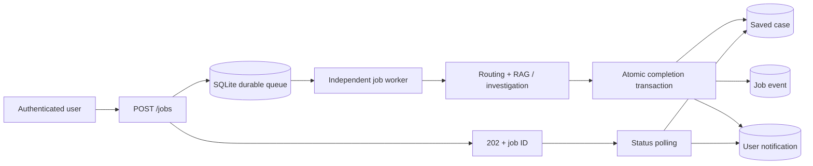

# Durable Background Jobs

The browser now submits work to a durable queue and receives HTTP 202 with a job ID. A separate worker process consumes the queued request, executes the existing RAG/investigation workflow, and atomically saves the case, completion event, and notification. The UI polls authenticated status and notification endpoints.



## Endpoints

| Endpoint | Behavior |
| --- | --- |
| POST /jobs | Validate and persist input; return 202 and Location without running the workflow |
| GET /jobs | List the signed-in user's recent jobs |
| GET /jobs/{id} | Read state, attempt count, error, and result URL |
| GET /jobs/{id}/events?after=0 | Read persisted lifecycle events with sequence pagination |
| GET /jobs/{id}/result | Read a completed case; return 409 until ready |
| GET /notifications | Read the user's terminal-job notifications |
| POST /notifications/{id}/read | Mark the user's notification read |

All endpoints require JWT authentication and enforce ownership. The synchronous POST /cases endpoint remains available for compatibility and the historical benchmark. Completed background cases are visible in GET /cases and can be used by the existing explicit integration endpoints.

## Delivery and Recovery

Jobs move through queued -> running -> succeeded, or running -> retrying -> running. After the configured attempt limit, a failed job remains available for inspection and generates a failure notification.

Submission and its queued event are committed together. Clients can supply an Idempotency-Key header; repeated requests with the same key and identical input return the same job. Different input with the same owner/key returns 409. Without a key, each submission creates a job.

A worker claims a job in a write transaction and receives a unique lease token. It renews the lease while processing. If a worker dies, another worker can reclaim the job after its lease expires. A stale worker cannot renew or commit using an old token. The system offers at-least-once computation with fenced, atomic result persistence; it does not promise exactly-once computation.

The case, succeeded state, completion event, and notification commit in one transaction. Transient RuntimeError failures use bounded exponential backoff; other workflow exceptions finish as failed. User-visible errors omit raw exception details. Notifications are stored in SQLite; the browser retrieves them through polling, so it can reconnect after reload.

No external ticket creation, model API call, Slack message, or email is automatically dispatched by this worker. Those operations retain their separate confirmation and integration credentials.

## Running

The local launcher starts both processes:

```sh
.venv-api/bin/python run_local.py
```

The root start-rag-demo.command uses this launcher. The supervisor stops both process groups when interrupted, including their support subprocesses. If either top-level process exits unexpectedly, restart the launcher; queued work remains stored.

For independent process management, run in two terminals from this directory with the same CASES_DB_PATH:

```sh
export SUPPORT_PYTHON="$PWD/.venv-support/bin/python"
export CASES_DB_PATH="$PWD/cases.sqlite3"
.venv-api/bin/python -m uvicorn api:api --host 127.0.0.1 --port 8765
```

```sh
export SUPPORT_PYTHON="$PWD/.venv-support/bin/python"
export CASES_DB_PATH="$PWD/cases.sqlite3"
.venv-api/bin/python job_worker.py
```

Configuration:

| Variable | Default |
| --- | --- |
| CASES_DB_PATH | platform/cases.sqlite3 |
| JOB_MAX_PENDING | 1000 queued, running, or retrying jobs combined |
| JOB_MAX_ATTEMPTS | 3 |
| JOB_LEASE_SECONDS | 60 |
| PORT | 8765 for run_local.py |

The queue rejects additional jobs with HTTP 503 and Retry-After when full. Inputs over 256 KB are rejected. SQLite uses WAL and FULL synchronization. This design is intended for one host and processes sharing a local database; multi-host deployment requires a queue/storage design appropriate for that environment.

## Verification

- 15 focused tests cover durability, idempotency, input/capacity limits, competing claims, heartbeat renewal, lease expiry, stale-worker fencing, retries, ownership, result persistence, and notifications.
- The full platform suite passes 55 tests.
- A real process test submitted a job while no worker was running, restarted the API, started and forcibly killed the first worker, then started a replacement. The job completed on attempt two with exactly one saved case and one notification.
- Browser verification covers HTTP 202 submission, queued status, result display, notifications, reopening a job after reload, and desktop/mobile layout without horizontal overflow or JavaScript page errors.

The existing 65,000-request performance figures describe synchronous warm-cache FAQ handling. They have not been remeasured for this queued path and should not be attributed to background-job throughput or latency.
